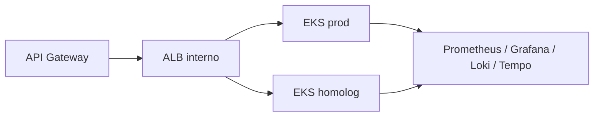

# Oficina Kubernetes Infra

Infraestrutura Kubernetes declarada em Terraform. A raiz continua sendo laboratório local (kind, minikube ou Docker Desktop). O diretório [`aws/`](aws/) contém a primeira versão do Terraform para VPC e cluster EKS gerenciado, **ainda não aplicado**.

## AWS Academy Learner Lab — Fase 3

O módulo `aws/` cria VPC própria, duas subnets públicas com acesso à Internet, duas privadas sem rota externa, EKS e um node group gerenciado. O banco RDS fica nas privadas e é criado pelo repositório `oficina-database-infra`. Os nós públicos evitam NAT Gateway nesta janela acadêmica, mas recebem IP cobrável; SSH deve permanecer fechado. O endpoint Kubernetes exige CIDR administrativo restrito. O módulo usa papéis `LabEksClusterRole` e `LabEksNodeRole` já existentes no Learner Lab — não os recria nem os destrói.

Configure `AWS_PROFILE=fiap-lab`, obtenha os ARNs dos dois papéis pela AWS CLI e forneça `TF_VAR_eks_cluster_role_arn`, `TF_VAR_eks_node_role_arn` e `TF_VAR_admin_cidrs` em ambiente local. No Learner Lab os nomes reais têm prefixo/sufixo gerado: procure `LabEks` na saída de `aws iam list-roles --profile fiap-lab`, não use `get-role --role-name LabEksClusterRole` literal. Não inclua credenciais, IP pessoal ou `terraform.tfvars` no Git. Use duas AZs permitidas; o padrão `us-east-1a`/`us-east-1b` foi conferido nesta conta, mas deve ser revisto em outra conta. Em `aws/`, `terraform init -backend=false`, `terraform fmt -check` e `terraform validate` funcionam sem state remoto; **`terraform plan` exige inicializar o backend S3 configurado**, portanto fica para a janela autorizada de criação do bucket. **Não aplique** antes da estimativa consolidada de EKS + EC2 + RDS + rede para a janela escolhida, sob teto de US$ 25. O state contém identificadores e deve ser protegido; CI/CD cloud exigirá backend remoto e identidade não expirada.

O módulo também cria um ALB **interno** compartilhado, target groups para NodePorts 30080 (produção) e 30081 (homologação), ECR imutável e Metrics Server. Os outputs `backend_listener_arn` e `ecr_repository_url` alimentam gateway e pipeline da API. O workflow `deploy-aws.yml` só aplica com `ENABLE_CLOUD_DEPLOY=true`; exige bucket S3 de state com versionamento, criptografia e bloqueio público, credenciais temporárias do Learner Lab e as variáveis descritas nele. `main` deve exigir PR e revisão do environment `cloud`. Nenhuma dessas peças foi implantada ainda. Após um `apply` autorizado, verifique `aws eks describe-cluster` e `aws eks update-kubeconfig --name oficina-fase3 --region us-east-1 --profile fiap-lab`, então `kubectl get nodes`. Ao destruir, reverta dependências na ordem API/Lambda/RDS/EKS e verifique recursos residuais cobrados. Os papéis IAM pré-existentes do laboratório nunca são alvo de `destroy`.

`aws/observability/` provisiona Prometheus, Grafana e Alertmanager **privados**, com retenção de métricas de 24 horas, dashboard técnico/de negócio e regras de indisponibilidade/falha de OS. O job exige `GRAFANA_ADMIN_PASSWORD` e um `ALERT_WEBHOOK_URL` escolhido pelo aluno; sem destino não há entrega de alerta. O dashboard pode ser acessado depois do deploy por `kubectl -n oficina-observability port-forward svc/grafana 3000:3000`, sem criar URL pública enquanto a avaliação não exigir. Métricas e alertas só serão evidência após dados reais e disparo controlado na AWS.



Tecnologias: Terraform AWS, EKS, ECR, ALB, Kubernetes, Prometheus, Grafana, Alloy, Loki e Tempo. APIs/Swagger pertencem à [aplicação](https://github.com/ElizeuVicente/fiap-tech-challenge); este repositório não expõe API de negócio. O script `scripts/bootstrap-state.sh` prepara o bucket de state **somente após** autorização explícita para criar recursos cobrados; não foi executado. Leia a [arquitetura integrada](https://github.com/ElizeuVicente/fiap-tech-challenge/blob/main/architecture/fase3-aws.md).

## Homologação local

Suba primeiro a API em `../oficina-tech-challenge` e a função em `../oficina-auth-lambda`; em seguida:

```bash
docker compose -f local/docker-compose.yml up -d
curl http://localhost:8000/actuator/health
```

Kong fica em `http://localhost:8000`, Prometheus em `http://localhost:9090` e Grafana em `http://localhost:3000`. O gateway limita a 60 requisições/minuto localmente e encaminha `/api` e `/auth/cpf`.

As regras locais ficam em `local/alerts.yml` e o dashboard técnico importável em `local/grafana-dashboard.json`.

```bash
terraform init -backend=false
terraform plan -var="kubeconfig_path=$HOME/.kube/config"
```

Nunca execute `apply` contra um cluster que não seja seu. No Learner Lab, OIDC não está disponível para a role observada: use credenciais de sessão curtas no environment protegido, atualizando-as a cada sessão. Configure proteção de `main` e a autorização de `soat-architecture` antes da entrega.
