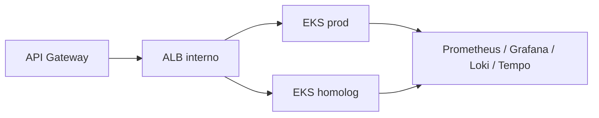

# Oficina Kubernetes Infra

Infraestrutura Kubernetes declarada em Terraform. A raiz continua sendo laboratório local (kind, minikube ou Docker Desktop). O diretório [`aws/`](aws/) contém VPC e cluster EKS gerenciado, implantados e validados no AWS Academy Learner Lab em 23/10/2026. O ambiente cloud é temporário e pode estar desligado após a janela de testes.

## AWS Academy Learner Lab — Fase 3

O módulo `aws/` cria VPC própria, duas subnets públicas com acesso à Internet, duas privadas sem rota externa, EKS e um node group gerenciado. O banco RDS fica nas privadas e é criado pelo repositório `oficina-database-infra`. Os nós públicos evitam NAT Gateway nesta janela acadêmica, mas recebem IP cobrável; SSH deve permanecer fechado. O endpoint Kubernetes exige CIDR administrativo restrito. O módulo usa papéis `LabEksClusterRole` e `LabEksNodeRole` já existentes no Learner Lab — não os recria nem os destrói.

Configure `AWS_PROFILE=fiap-lab`, obtenha os ARNs dos dois papéis pela AWS CLI e forneça `TF_VAR_eks_cluster_role_arn`, `TF_VAR_eks_node_role_arn` e `TF_VAR_admin_cidrs` em ambiente local. No Learner Lab os nomes reais têm prefixo/sufixo gerado: procure `LabEks` na saída de `aws iam list-roles --profile fiap-lab`, não use `get-role --role-name LabEksClusterRole` literal. Não inclua credenciais, IP pessoal ou `terraform.tfvars` no Git. Use duas AZs permitidas; o padrão `us-east-1a`/`us-east-1b` foi conferido nesta conta, mas deve ser revisto em outra conta. Em `aws/`, `terraform init -backend=false`, `terraform fmt -check` e `terraform validate` funcionam sem state remoto; **`terraform plan` exige inicializar o backend S3 configurado**. **Não aplique** antes da estimativa consolidada de EKS + EC2 + RDS + rede e da autorização da janela: em 23/10/2026 o limite concedido foi US$ 10. O state contém identificadores e deve ser protegido; CI/CD cloud exige backend remoto e identidade não expirada.

O módulo também cria um ALB **interno** compartilhado, target groups para NodePorts 30080 (produção) e 30081 (homologação), ECR imutável e Metrics Server. Os outputs `backend_listener_arn` e `ecr_repository_url` alimentam gateway e pipeline da API. O ECR do challenge usa `force_delete=true`: **`terraform destroy` apaga também as imagens publicadas nele**; exporte alguma imagem antes se precisar preservá-la. Isso evita armazenamento residual após a demonstração, sem afetar outros repositórios ECR. O workflow `deploy-aws.yml` só aplica com `ENABLE_CLOUD_DEPLOY=true`; exige bucket S3 de state com versionamento, criptografia e bloqueio público, credenciais temporárias do Learner Lab e as variáveis descritas nele. Para repetir uma janela com dois nós, configure `NODE_DESIRED_SIZE=2` nas variáveis do repositório; sem ela, o workflow preserva o padrão de um nó. `main` deve exigir PR e revisão do environment `cloud`. Após um `apply` autorizado, verifique `aws eks describe-cluster` e `aws eks update-kubeconfig --name oficina-fase3 --region us-east-1 --profile fiap-lab`, então `kubectl get nodes`. Ao destruir, reverta dependências na ordem API/Lambda/RDS/EKS e verifique recursos residuais cobrados. Os papéis IAM pré-existentes do laboratório nunca são alvo de `destroy`.

`aws/observability/` provisiona Prometheus, Grafana e Alertmanager **privados**, com retenção de métricas de 24 horas, dashboard técnico/de negócio e regras de indisponibilidade/falha de OS. Para a demonstração sem dependência de um serviço externo, o módulo também cria `webhook-receiver`: use `ALERT_WEBHOOK_URL=http://webhook-receiver.oficina-observability.svc.cluster.local:8080/` e confira a entrega por `kubectl -n oficina-observability logs deployment/webhook-receiver`. O receptor registra apenas nome e estado dos alertas, sem payload completo, e devolve HTTP 204. O job exige `GRAFANA_ADMIN_PASSWORD` e `ALERT_WEBHOOK_URL`; sem destino não há entrega de alerta. O dashboard pode ser acessado durante o deploy por `kubectl -n oficina-observability port-forward svc/grafana 3000:3000`, sem criar URL pública. Em 23/10/2026 o dashboard, Prometheus, Loki, Tempo e a entrega de um alerta sintético `firing` foram testados no EKS; o HPA escalou a API de homologação de um para dois pods sob carga controlada.



Tecnologias: Terraform AWS, EKS, ECR, ALB, Kubernetes, Prometheus, Grafana, Alloy, Loki e Tempo. APIs/Swagger pertencem à [aplicação](https://github.com/ElizeuVicente/fiap-tech-challenge); este repositório não expõe API de negócio. O script `scripts/bootstrap-state.sh` prepara o bucket de state **somente após** autorização explícita para criar recursos cobrados; foi usado na janela autorizada de 23/10/2026. O [run cloud de EKS/observabilidade](https://github.com/ElizeuVicente/oficina-kubernetes-infra/actions/runs/39997621609) terminou com sucesso. Leia a [arquitetura integrada](https://github.com/ElizeuVicente/fiap-tech-challenge/blob/main/architecture/fase3-aws.md).

## Homologação local

Suba primeiro a API em `../oficina-tech-challenge` e a função em `../oficina-auth-lambda`; em seguida:

```bash
docker compose -f local/docker-compose.yml up -d
curl http://localhost:8000/actuator/health
```

Kong fica em `http://localhost:8000`, Prometheus em `http://localhost:9090` e Grafana em `http://localhost:3000`. O gateway limita a 60 requisições/minuto localmente e encaminha `/api` e `/auth/cpf`.

As regras locais ficam em `local/alerts.yml` e o dashboard técnico importável em `local/grafana-dashboard.json`.

```bash
terraform init -backend=false
terraform plan -var="kubeconfig_path=$HOME/.kube/config"
```

Nunca execute `apply` contra um cluster que não seja seu. No Learner Lab, OIDC não está disponível para a role observada: use credenciais de sessão curtas no environment protegido, atualizando-as a cada sessão. Configure proteção de `main` e a autorização de `soat-architecture` antes da entrega.

## Dependências temporárias da Fase 4

`aws/phase4/dependencies.yaml` prepara MongoDB autenticado em replica set de um nó e RabbitMQ autenticado no namespace indicado por `kubectl -n`. Antes de aplicar, crie os Secrets `oficina-mongo-config` (`MONGO_INITDB_ROOT_USERNAME`, `MONGO_INITDB_ROOT_PASSWORD`, `MONGO_KEYFILE`) e `oficina-rabbitmq-config` (`RABBITMQ_DEFAULT_USER`, `RABBITMQ_DEFAULT_PASS`) fora do Git. O Job inicializa a réplica para o nome DNS usado em `oficina-prod`; altere-o junto da configuração dos clientes se usar outro namespace. Configure conexão autenticada e não exponha esses serviços publicamente.

**Somente demonstração:** os dados usam armazenamento efêmero (`emptyDir`). A substituição do Pod pode apagar dados e exigir reinicializar a réplica; não é configuração para produção nem estratégia de backup. Para uma implantação durável, use volumes persistentes, backup, recuperação e alta disponibilidade. O controle de custos exige acompanhar o EKS, nós, balanceador, RDS e os recursos residuais também após encerrar a sessão do laboratório.

A opção `phase4_http_api_id` conecta a rota `ANY /api/{proxy+}` de um HTTP API existente ao ALB interno por VPC Link; não altera sua rota de webhook. A autenticação nessa rota é feita pela própria API da OS, sem authorizer no Gateway. O trecho entre Gateway e ALB usa HTTP privado, portanto não fornece criptografia ponta a ponta. Para reproduzir a implantação, forneça esse ID, as roles e o CIDR de administração em `*.tfvars` local ignorado e configure o número de nós desejado. Omitir esses valores em um próximo plano pode propor remoção da rota ou redução dos nós: revise sempre o plano antes de aplicar. O API Gateway e a VPC Link também devem ser inventariados ao encerrar o laboratório.

Na Fase 4, o listener do ALB privado encaminha `/webhooks/mercadopago` ao NodePort 30082 do Billing. As regras de rede aceitam o tráfego do ALB apenas a partir dos grupos de segurança dos nós EKS. A integração e a rota do webhook no API Gateway existente são gerenciadas por Terraform; importe os recursos já existentes para o state antes do primeiro plano. As credenciais permanecem em Secrets fora do Git. Ao destruir estes recursos, a rota existente também será removida; planeje o retorno e preserve os dados.
